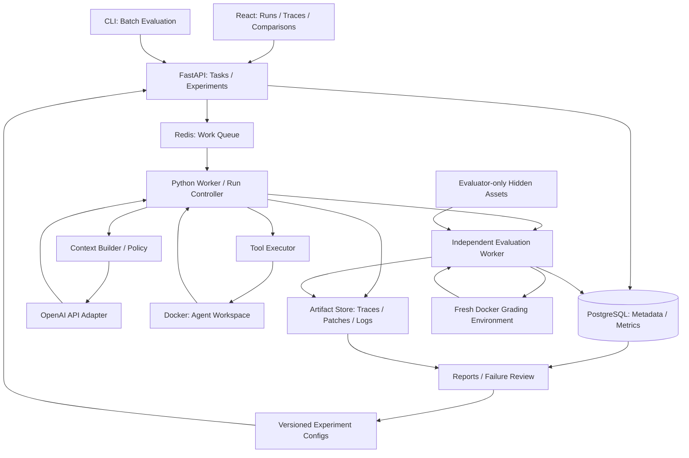

# Solve Loop

> Long-horizon Coding Agent Evaluation & Optimization Platform

**Status:** Initial specification — implementation and performance results are pending.
**Repository:** `reha-design/solve-loop` · **Portfolio focus:** Applied AI Engineer / Coding Agent Reliability

## Purpose

Solve Loop은 실제 코딩 작업을 끝까지 수행하는 에이전트를 만들고, 실행 기록과 평가 결과를 통해 그 신뢰성을 반복적으로 개선하는 실험 플랫폼이다. 핵심 산출물은 코드 패치, 재현 가능한 평가, 그리고 개선 효과를 설명하는 증거다.

**Central question:** 동일한 모델과 실행 예산에서 context construction, tool policy, failure recovery를 바꾸면 더 많은 문제를 더 적은 비용과 사람의 개입으로 해결할 수 있는가?

GitHub Issue 또는 task manifest를 입력받아 저장소 분석 → 계획 → 수정 → 테스트 → 복구 → 최종 패치를 수행한다. Baseline과 개선 버전을 같은 작업에서 비교하고 성공률·회귀·토큰·시간·비용을 함께 보고한다. 이 문서의 수량과 예산은 개발 계획이며, 측정된 성과를 의미하지 않는다.

## Problem Statement

짧은 코드 생성 데모는 여러 파일과 반복 실행이 필요한 실제 작업의 안정성을 보여주기 어렵다. 긴 작업에서는 관련 코드 누락, 컨텍스트 과잉, 잘못된 도구 호출, 환경 실패, 반복 수정, 성급한 완료 선언이 누적된다.

모델 출력만 평가하면 이러한 실패가 가려진다. Solve Loop은 전체 실행 과정을 관측하고, 실패 원인을 분리하고, 하나의 개선이 성공률과 비용에 미치는 영향을 검증한다. 성공한 몇 가지 사례보다 실패를 포함한 전체 평가 결과를 포트폴리오의 중심에 둔다.

## Target Job Mapping

아래 매핑은 제공된 Applied AI Engineer 역할 설명에 기반한다. 특정 채용 공고의 현재 모집 상태를 주장하지 않는다.

| Role requirement | Project evidence |
| --- | --- |
| Long-horizon agent behavior | 명시적 상태 전이, 예산 관리, 테스트 기반 복구, 중단 및 재개 기록 |
| Evals and regression analysis | 고정 task manifest, 독립 grader, baseline/candidate 비교, 회귀 목록 |
| Prompt, context, and tool experiments | 버전 관리된 정책, context selector ablation, 도구 오류 분석 |
| Production reliability | timeout, API retry, worker crash, sandbox failure에 대한 fault injection |
| Token, latency, and cost optimization | 품질·비용 Pareto 비교, 단계별 소요 시간, 토큰 사용 명세 |
| Feedback and data systems | 실행 trace → 검토된 실패 라벨 → 새 회귀 task → 재평가 |
| Product and user outcomes | 최종 패치, 검증 증거, 사람 개입 횟수, trace inspection UI |
| Python and systems engineering | typed Python modules, API/worker 분리, sandbox·DB·queue 경계 |

## Non-Goals

- 범용 IDE, 완전한 개발자 대체, 자동 production 배포 또는 무인 PR merge.
- 자체 foundation model 학습이나 초기 단계의 fine-tuning.
- MVP의 multi-agent orchestration, multi-language 지원, 대규모 multi-tenant SaaS.
- 근거 없는 leaderboard 우위 주장, 테스트 통과만으로 실무 품질 전체를 보장하는 주장.
- 공개 저장소에 private source, 평가용 정답, 사용자 비밀 또는 원본 민감 trace 공개.

## Core Agent Execution Loop

1. **Ingest:** task ID, issue text, repo/base commit, 환경 정의와 budget을 고정한다.
2. **Prepare:** task 전용 sandbox를 생성하고 공개된 기존 테스트와 환경 상태를 확인한다.
3. **Understand:** 저장소 구조와 관련 파일을 검색하고 근거를 context에 포함한다.
4. **Plan:** 수정 가설, 변경 범위, 검증 방법을 짧은 구조화된 계획으로 기록한다.
5. **Act:** 모델이 요청한 도구 호출을 검증하고 sandbox 안에서 실행한다.
6. **Observe:** 도구 결과, diff, 테스트 결과, budget 잔량을 기록하고 context를 갱신한다.
7. **Recover:** 실패를 분류하여 새 가설, 선택적 재검색, patch rollback 또는 제한된 retry를 수행한다.
8. **Finalize:** 패치와 공개 테스트 증거를 저장한다. 별도의 evaluator가 숨겨진 테스트로 최종 판정한다.

상태는 `queued → preparing → running → evaluating → terminal`로 관리한다. 실행 중에는 understand/plan/act/observe/recover 단계를 이벤트로 남긴다. 최종 상태는 `solved`, `unsolved`, `budget_exhausted`, `infra_error`, `cancelled`로 구분하고 assisted 여부를 별도 보존한다. 에이전트의 완료 선언만으로 `solved`가 되지 않는다.

Long-horizon은 여러 파일·도구 단계·수정 및 검증 사이클을 필요로 하는 작업으로 정의한다. 실제 step 수와 시간을 공개하며, 단순히 오래 실행된 작업을 복잡한 작업으로 간주하지 않는다.

## Tools

| Tool | Contract |
| --- | --- |
| `repo_search` | 파일/심볼/텍스트 검색; 경로·줄 번호와 제한된 결과 반환 |
| `read_file` | 지정 범위 읽기; 크기 제한과 workspace 경계 검사 |
| `apply_patch` | 구조화된 patch 적용; 변경 파일과 실패 사유 반환 |
| `run_shell` | sandbox 내부 명령 실행; timeout·stdout/stderr 제한·exit code 기록 |
| `run_tests` | 공개 테스트 실행; command, duration, 결과와 로그 참조 반환 |
| `git_diff` | base commit 대비 변경 확인; 최종 patch artifact 생성 |

모든 도구는 typed schema, request ID, 시작/종료 시각, 결과 상태, 오류 코드를 가진다. shell은 도구별 경계 검사를 우회할 수 있으므로 보안 경계는 sandbox 전체에 적용한다. 일반적인 테스트 assertion 실패는 tool error와 별도로 기록한다. 추론과 패치 생성은 worker가 OpenAI API로 수행하고, 실제 도구 실행은 플랫폼이 관리한다.

## Context Builder

- **Baseline:** issue text, repository map, 단순 검색 결과, 최근 도구 결과를 고정된 규칙으로 구성한다.
- **Candidate:** issue symbol·stack trace·최근 테스트 실패를 이용해 관련 파일을 선택하고 중복 내용과 오래된 로그를 줄인다.
- **Priority:** task와 제약 → 현재 계획 → 관련 코드/테스트 → 최신 오류 → 과거 작업 요약.
- **Budget:** input/output 여유분을 분리하고 파일 범위, 검색 결과 수, tool output 크기를 제한한다. 잘린 결과에는 truncation 표시와 재조회 경로를 붙인다.
- **Memory:** 수정 파일, 검증 결과, 실패 가설, 미해결 질문을 구조화해 보존한다. 요약에는 원본 이벤트 참조를 연결한다.
- **Audit:** 선택 파일·범위·선정 이유·context hash·사용량을 기록한다. 후보 selector는 baseline과 동일한 총 budget에서 비교한다.

저장소 문서와 도구 출력은 신뢰되지 않는 데이터로 취급한다. evaluator의 hidden test, gold patch, 미래 commit은 agent context와 검색 대상에 포함하지 않는다.

## Docker Sandbox

task마다 고정된 base commit과 image digest로 독립된 Linux Docker 환경을 생성한다. 개발 호스트가 Windows라면 Docker Desktop의 Linux engine/WSL2를 사용한다.

- CPU, memory, process 수, disk, command timeout과 전체 task deadline을 제한한다.
- non-root, capability 제한, privileged mode 금지, host Docker socket/개인 디렉터리 mount 금지를 기본으로 한다.
- 의존성 준비는 통제된 build 단계에서 수행하고 agent 실행 시 네트워크를 기본 차단한다.
- API key와 플랫폼 자격 증명은 worker에만 두고 task container에 전달하지 않는다.
- evaluator는 별도 환경에서 패치를 적용하고 hidden tests를 주입한다. hidden assets는 agent container에 mount하지 않는다.
- 중단·실패 시 process/container를 정리하고 patch·로그·환경 fingerprint는 보존한다.

Docker는 완전한 적대적 코드 격리를 보장하지 않는다. MVP는 승인된 저장소를 전용 worker에서 실행하며, 공개 임의 코드 서비스는 별도 강격리 설계를 요구한다.

## Evaluation Harness

**Task manifest:** `task_id`, `source`, `repo`, `base_commit`, `issue_text`, `environment_digest`, `public_test_command`, `grader_ref`, `split`, `budgets`, `provenance`. `grader_ref`는 evaluator 전용 자산 참조이며 agent payload에는 넣지 않는다.

**Run record:** task/config/model/prompt/tool/context 버전, run ID, attempt ID, timing, usage, patch hash, event log, terminal status, grader result와 human intervention 기록.

**Grading:** clean base checkout에 candidate patch를 적용한다. SWE-bench는 공식 harness의 판정을 사용한다. Private task는 사전에 정의된 acceptance tests와 기존 동작 regression tests를 사용한다. 정답 테스트 변경이나 검증 우회가 포함된 patch는 성공으로 인정하지 않는다. LLM judge는 보조 라벨링에만 사용한다.

**Reproducibility:** dataset revision, task 목록, agent commit, image digest, model identifier/snapshot(가능한 경우), sampling 설정, 가격표 버전, raw grader artifacts를 함께 저장한다. 새로운 패치 평가에는 새로운 evaluation run ID를 사용해 오래된 cache 재사용을 방지한다. 환경을 재현할 수 있어도 모델 응답이 bit-for-bit 동일하다는 보장은 하지 않는다.

## Metrics

기본 단위는 **task × configuration × repetition**의 한 run이다. 내부 retry와 복구 비용도 그 run에 포함한다. 고정 manifest의 예정 run 수를 `N`으로 두며, 누락·취소·timeout·infra error도 1차 solve rate 분모에 남긴다. 원인별 수와 정상 grading 대상만의 보조 지표를 함께 공개한다.

| Metric | Definition and reporting |
| --- | --- |
| Solve rate | 독립 grader를 통과하고 사람의 task별 도움 없이 해결한 run 수 / N. Assisted solve rate는 별도 표시 |
| Regression rate | 같은 task/repetition에서 baseline은 해결했으나 candidate는 실패한 수 / baseline 해결 수. 짝지은 비교가 없거나 분모가 0이면 N/A |
| Tokens/task | 모든 모델 호출의 input + output token 합. cached input과 reasoning 세부 항목은 지원 시 별도 표시하고 중복 합산하지 않음 |
| Latency/task | worker가 준비를 시작한 시점부터 grading 완료까지의 wall time. queue wait·sandbox setup·agent·grading을 분리; median/p95 보고 |
| Cost/task | 호출별 사용량 × 실행 당시 버전 관리된 단가 + 유료 도구 비용. 캐시 단가 구분; 모델/API 비용과 sandbox compute 비용 분리 |
| Tool errors | schema·실행·timeout 등 오류 호출 수 / 전체 도구 호출 수와 task당 오류 수. 테스트 실패는 별도 test outcome |
| Iteration count | 모델 호출 후 도구 결과를 반영하는 한 act/observe 사이클 수. patch/test 사이클도 보조 집계 |
| Human intervention rate | 실행 시작 후 task별 힌트·수동 수정·수동 재개가 있었던 run 수 / N. 개입 유형과 횟수도 기록 |

tokens/cost/iteration은 실패 run까지 포함해 평균·median·p95 및 총합을 보고한다. missing usage는 0으로 채우지 않고 missing 비율을 표시한다. `cost per solved task = 전체 run 비용 / autonomous solved 수`도 보고하며 해결 수가 0이면 N/A다. Candidate patch의 기존 테스트 파손률은 agent 버전 간 regression rate와 별도의 지표로 유지한다.

## Failure Taxonomy

| Category | Examples | Evidence |
| --- | --- | --- |
| Task understanding | 요구사항 오해, edge case 누락 | 계획과 acceptance criteria의 불일치 |
| Localization / context | 잘못된 파일 선택, 핵심 코드 누락 | 검색 및 context 선택 기록 |
| Planning / implementation | 가설 오류, 불완전 수정, 기능 회귀 | diff와 테스트 실패 |
| Tool use | 잘못된 인자, 실행 경로 오류, patch 적용 실패 | tool schema/exit/error 기록 |
| Verification | 필요한 테스트 생략, 테스트 결과 오독 | 실행 명령과 완료 선언 비교 |
| Recovery / control | 같은 오류 반복, 불필요한 수정, budget 소진 | 상태 전이와 반복 패턴 |
| Environment / infrastructure | dependency failure, container crash, API 장애 | worker/container/provider 로그 |
| Evaluation integrity | hidden asset 접근 시도, 테스트 우회, 오염 | grader 및 접근 감사 기록 |

최초 실패 지점, 주요 원인 하나, 복수 기여 요인, 근거 이벤트, reviewer confidence를 저장한다. 원인 불명은 `unknown`으로 남긴다. 자동 라벨은 제안으로 취급하고 사람이 표본 검토하며, disagreement와 taxonomy 버전을 보존한다.

## Experiment Design

1. **Freeze baseline:** 단일 agent, 단순 context, 기본 prompt, 제한된 retry로 시작한다.
2. **Register hypothesis:** 예상 메커니즘, primary metric, 비용/회귀 guardrail, task split, 반복 수와 중단 조건을 결과 확인 전에 기록한다.
3. **Change one factor:** context selection → recovery policy → tool output compression 순으로 실험한다. 결합 버전은 개별 ablation 이후 평가한다.
4. **Control conditions:** 모델·sampling·task manifest·총 토큰/시간/비용 상한·hardware·concurrency를 고정한다. 실행 순서를 섞고 warm/cold cache 조건을 명시한다.
5. **Repeat and compare:** 주요 비교는 task당 3회 반복을 계획하고 task 단위 paired bootstrap으로 95% confidence interval을 구한다. 작은 표본은 탐색 결과로 표시한다.
6. **Report all outcomes:** solve rate 차이, baseline-only/candidate-only 해결 목록, 실패 분류, 비용·시간 trade-off를 공개한다. 유리한 run만 고르거나 실패 run을 제외하지 않는다.

초기 promotion 기준은 holdout solve rate 개선과 사전 등록된 비용·회귀 guardrail 충족이다. Phase 1 baseline 이후 수치 기준을 정하고 candidate 결과를 보기 전에 고정한다. 통계적 불확실성이 크면 추가 평가하거나 inconclusive로 보고한다. 모델 변경 실험은 execution policy 변경과 분리한다.

## Benchmark Strategy

- **Smoke suite:** 직접 통제 가능한 5개 Python task로 ingestion, patch, grading과 실패 상태를 검증한다.
- **SWE-bench:** 개발은 제공된 development split 중심으로 진행한다. 공식 test pool에서는 repo/문제 유형을 고려해 사전 고정한 20개 pilot task를 사용하고, 최종에는 별도의 50개 holdout task로 확장한다. Lite/Verified 사이 중복 instance를 제거하고 dataset revision과 instance ID를 공개한다.
- **Official grading:** SWE-bench patch를 공식 Docker harness로 평가한다. 부분집합 결과는 subset 이름·분모·선정 방법과 함께 보고하며 full benchmark 또는 공식 leaderboard 성과로 표현하지 않는다. 실제 장기 작업 복잡성은 별도로 측정한다.
- **Private real-world tasks:** 직접 소유하거나 사용 허가를 받은 저장소에서 multi-file bugfix, 테스트 복구, API 변경, refactor 등 10–20개 작업을 수집한다. 원본 snapshot, acceptance tests, 권한·라이선스·수집 시점을 기록한다.
- **Split discipline:** 개발·pilot·holdout을 분리하고 private tasks는 가능한 한 repo 단위와 시간 기준으로 분리한다. 숨겨진 test와 gold patch를 agent에게 제공하지 않는다. 확인한 holdout 실패를 개발에 활용했다면 해당 작업을 holdout에서 은퇴시키고 새 작업으로 보충한다.
- **Contamination:** 공개 benchmark는 학습 데이터 오염 가능성을 명시하고, 새 private task 결과를 별도 표로 보고한다. 공개/비공개 점수를 하나로 합치지 않는다.

private 자산은 이 public repository에 커밋하지 않는다. 공개 가능한 manifest schema, synthetic examples, 익명화된 aggregate와 허가받은 trace만 제공한다.

## Feedback Loop

`Run → Trace → Failure review → Hypothesis → Policy change → Paired eval → Regression gate → Release`

실패 task를 우선순위(빈도 × 사용자 영향 × 개선 가능성)로 검토한다. 검토된 실패를 sanitized regression case로 만들고 정책 변경의 근거와 연결한다. 회귀 suite는 개발용이며 별도의 미사용 holdout을 대체하지 않는다. 실제 사용자 작업은 동의·보존 기간·비식별화 규칙을 정한 뒤 수집하고 자동 학습이나 원본 공개를 기본값으로 두지 않는다.

## Architecture



Metadata는 PostgreSQL에, 큰 artifacts는 초기에는 local volume에 저장하고 이후 S3-compatible storage로 확장한다. Redis는 queue 용도로 사용하며 영속적인 평가 결과의 정본은 DB와 artifact store에 둔다.

Worker는 run 상태의 업데이트를 책임지고 이벤트를 append-only로 기록한다. Queue 재전달은 idempotency key와 lease로 처리하며, crash 복구 시 새 attempt를 연결하고 중복 비용을 감추지 않는다. 체크포인트 이후의 shell 실행을 무조건 재실행하지 않는다. Core entities는 `Task`, `Experiment`, `AgentConfig`, `Run`, `Attempt`, `Event`, `Artifact`, `Evaluation`, `FailureLabel`이다.

## Recommended Stack

이 구성은 초기 설계 선택이며 구체적인 dependency version은 구현 단계에서 lock한다.

| Layer | Choice | Rationale |
| --- | --- | --- |
| Agent / harness | Python, Pydantic, pytest | typed contracts, 실험 코드와 테스트 도구 통합 |
| API | FastAPI | task/run 조회와 batch 실행 요청 |
| Metadata | PostgreSQL, SQLAlchemy, Alembic | 실행·실험·평가 관계와 schema migration |
| Queue | Redis with a Python worker queue | 느린 실행 분리와 제한된 concurrency; 결과는 DB에 보존 |
| Sandbox | Docker, Docker Compose | 고정 환경, 로컬 실행, 독립 grading |
| UI | React, TypeScript, Vite | run 비교, trace 탐색, failure filtering |
| Model | OpenAI API, Python SDK, Responses API tool calling | 모델 adapter와 플랫폼 tool executor 분리 |
| Artifacts / reporting | JSONL, Parquet, local volume → S3-compatible storage | 원본 trace 보존과 batch 분석 |
| Quality | uv, Ruff, pytest, GitHub Actions | dependency 고정과 단위·통합·smoke checks |

초기에는 직접적인 단일-agent loop로 상태와 비용을 관측한다. API key는 환경 변수 또는 secret store에서 읽고 로그에서 제거한다. CI는 mock provider와 작은 sandbox fixture를 사용하며 유료 모델 benchmark는 명시적인 budget을 가진 별도 작업으로 실행한다.

## Repository Structure

아래는 **계획된 구조**다. 초기 커밋에는 이 `PROJECT.md`만 포함한다.

```text
solve-loop/
├── PROJECT.md
├── README.md
├── pyproject.toml
├── uv.lock
├── .env.example
├── .gitignore
├── compose.yaml
├── src/solve_loop/
│   ├── agent/          # loop, state, planning, recovery
│   ├── context/        # selection, budgets, summaries
│   ├── tools/          # typed tool contracts and executor
│   ├── sandbox/        # Docker lifecycle and limits
│   ├── providers/      # OpenAI adapter, usage accounting
│   ├── evals/          # private task grader, SWE-bench adapter
│   ├── experiments/    # scheduling, comparisons, regression gates
│   ├── telemetry/      # events, metrics, redaction
│   ├── api/            # FastAPI routes
│   ├── workers/        # queue consumers and leases
│   └── storage/        # DB models and artifact references
├── frontend/           # React run/trace/comparison views
├── configs/            # versioned agent and experiment configs
├── benchmarks/         # public manifests and synthetic fixtures
├── docker/             # worker and task environment definitions
├── migrations/
├── tests/              # unit, integration, sandbox, smoke
├── scripts/            # run, evaluate, export reports
├── docs/               # architecture, methodology, failure taxonomy
├── reports/            # reviewed, sanitized results
└── .github/workflows/
```

Private task data, gold patches, hidden tests, secrets, raw traces, downloaded repos와 generated artifacts는 git에서 제외한다.

## Development Phases

| Phase | Scope | Milestone and exit criteria |
| --- | --- | --- |
| 1 — Observable Baseline | CLI, single agent loop, typed tools, Docker lifecycle, immutable events, independent grading | **M1:** smoke 5개에서 ingest → patch → grade 경로 동작. 성공/실패/timeout/infra error 기록과 cleanup 검증. **M2:** 고정 pilot 20개 baseline 실행 및 비용·trace 포함 보고서 |
| 2 — Evaluation System | SWE-bench adapter, private task schema, DB/queue, metrics, failure review, comparison reports | **M3:** 같은 manifest를 새 run ID로 재평가 가능. 8개 핵심 지표 산출, grader 격리·실패 분모 처리 검증 |
| 3 — Optimization MVP | context selector 1개, bounded recovery 1개, paired ablations, minimal React UI | **M4:** baseline/개별 개선/결합 버전의 동일 조건 pilot 비교. trace에서 failure label과 patch/test 증거 확인 가능. 개선 여부와 무관하게 결과·한계 공개 |
| 4 — Portfolio Release | 미사용 holdout 50개 및 private task 평가, crash/API fault injection, 문서화 | **M5:** 3회 반복을 계획한 holdout 비교, confidence interval, 회귀 사례, 비용 trade-off와 재현 가이드 공개. 결과 불확실성은 명시 |

Phase 일정은 baseline 비용과 환경 준비 결과를 확인한 뒤 정한다. 큰 benchmark 실행 전에 pilot의 실제 task당 비용으로 총 예산을 계산하고 experiment ceiling을 설정한다.

## MVP Definition

**MVP = Python coding task를 sandbox에서 실행하고, baseline과 개선 정책의 결과를 독립 평가 및 trace로 비교할 수 있는 최소 플랫폼.** Phase 3 종료 시 다음 조건을 충족한다.

- [ ] issue text와 pinned repository manifest를 받아 isolated run을 실행한다.
- [ ] search/read/patch/shell/test/diff 도구와 budget stop, 제한된 recovery가 동작한다.
- [ ] agent가 볼 수 없는 acceptance/regression tests로 최종 패치를 평가한다.
- [ ] 5개 smoke fixture와 고정 20개 pilot task를 실행하고 모든 run 상태를 보존한다.
- [ ] solve rate, regression rate, tokens/task, latency/task, cost/task, tool errors, iteration count, human intervention rate를 산출한다.
- [ ] baseline과 context/recovery 후보를 같은 budget에서 비교하고 실패를 라벨링한다.
- [ ] 최소 UI에서 run 목록, baseline/candidate 비교, trace·diff·test evidence를 확인한다.
- [ ] 하나의 문서화된 명령으로 로컬 서비스와 평가 절차를 시작할 수 있다.
- [ ] secrets/private assets 제외와 container cleanup, timeout, retry, evaluator isolation을 검증한다.

성과 목표는 사전 측정된 baseline 이후 정한다. MVP 완료와 성능 향상 입증은 별개의 판단이며, negative result도 실험 조건과 증거가 충실하면 유효한 산출물이다.

## Portfolio Evidence

최종 README에는 baseline/candidate 지표 표, 표본 수와 confidence interval, 개선 전후 trace 사례, 실패/회귀 사례, 구조도, 재현 명령, 비용 및 평가 한계를 담는다. 각 숫자는 config·commit·manifest·run artifacts로 추적 가능해야 한다. 사용자 가치의 보조 근거는 autonomous completion, cost per solved task, 사람 개입 감소이며, 실제 검증 없이 금전적 절감 효과를 단정하지 않는다.

## References

공식 문서 확인일: 2026-10-08. 구현 시 dataset/harness/API 버전을 다시 확인한다.

- [SWE-bench Evaluation Guide](https://www.swebench.com/SWE-bench/guides/evaluation/) — 공식 patch 평가 및 Docker harness.
- [SWE-bench Lite](https://www.swebench.com/lite.html) — 초기 평가용 benchmark 선택 참고.
- [SWE-bench Verified](https://www.swebench.com/verified.html) — 후속 평가 pool 선택 참고.
- [OpenAI Function Calling](https://developers.openai.com/api/docs/guides/function-calling) — 모델의 도구 요청과 애플리케이션의 실행 책임 분리.
